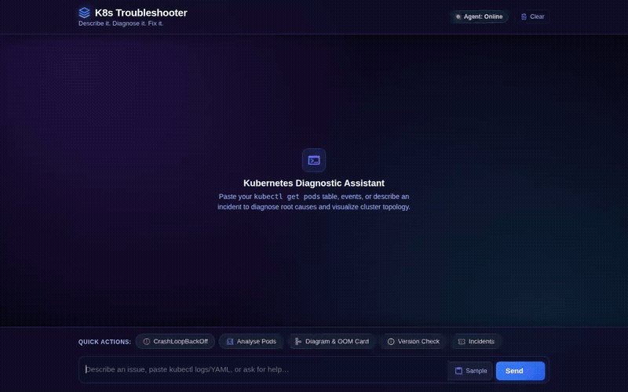

# K8s Troubleshooter

**Describe it. Diagnose it. Fix it.**

An intelligent Kubernetes troubleshooting assistant built with the Google Agent Development Kit (ADK) and deployed to Google Cloud Agent Platform (Agent Runtime). The agent diagnoses pod crash loops, image pull failures, and memory exhaustion, queries verified runbooks and tracks incidents in Firestore, inspects release lifecycles, generates cluster topology diagrams with Gemini, executes code in a secure sandbox, and renders rich diagnostic cards using A2UI.

---



---

## What the Agent Does

K8s Troubleshooter combines automated diagnostics, cloud incident storage, external API lookups, sandboxed telemetry processing, and adaptive UI rendering to streamline Kubernetes incident response:

### 1. Incident & Runbook Management (Firestore)
* **Runbook Search (`search_runbooks`)**: Searches verified troubleshooting procedures in Firestore for common issues such as `CrashLoopBackOff`, `OOMKilled`, `ImagePullBackOff`, `CreateContainerConfigError`, and `NodeNotReady`.
* **Incident Tracking (`create_incident`, `update_incident`, `list_incidents`)**: Logs incidents with cluster details, affected namespaces, pod names, error statuses, triage steps, and resolution states.

### 2. Live Kubernetes Lifecycle API Lookups
* **Version Support Verification (`check_k8s_version_support`)**: Queries endoflife.date for Kubernetes release cycles, support status, and end-of-life dates to identify cluster version skew or deprecated API risks.

### 3. Cluster Architecture & Topology Diagrams
* **Diagram Generation (`generate_cluster_diagram`)**: Uses `gemini-3.1-flash-lite-image` to generate cluster topology and fault architecture diagrams, highlighting failing pods, nodes, and network paths.
* **Dual Delivery**: Saves the image artifact locally via ADK's `tool_context.save_artifact` and uploads it to a public Google Cloud Storage bucket (`gs://k8s-troubleshooter-diagrams-e954671c`), returning a public HTTPS URL.

### 4. Code Execution Sandbox (`AgentEngineSandboxCodeExecutor`)
* Evaluates raw unparsed logs, container stack traces, and metrics by running Python analysis scripts inside a secure Agent Engine sandbox environment.

### 5. Cross-Session Long-Term Memory (`VertexAiMemoryBankService`)
* Backed by Vertex AI Memory Bank on Agent Engine.
* Employs `PreloadMemoryTool` to recall cluster context across sessions (cluster distribution, namespace conventions, recurring incident history) and an `after_agent_callback` to generate and persist memories.

### 6. Agent-First Rich Display (A2UI v0.8)
* Emits A2UI cards, columns, rows, dividers, and images via `A2uiSchemaManager` (v0.8 Basic Catalog).
* Renders rich interactive diagnostics with health, warning, and failure status badges directly in the chat interface instead of plain text.

---

## Architecture Overview

```
                      +---------------------------------------+
                      |       Web Frontend (Cloud Run)        |
                      |  - Cyberpunk Midnight Neon UI         |
                      |  - Built-in A2UI Mini-Renderer        |
                      |  - FastAPI Proxy (ADC Authentication) |
                      +-------------------+-------------------+
                                          |
                                     A2A Protocol
                                          |
                                          v
                      +---------------------------------------+
                      |      Agent Engine (Agent Runtime)     |
                      |         Reasoning Engine              |
                      +---+---------------+---------------+---+
                          |               |               |
     +--------------------+       +-------+-------+       +--------------------+
     |                            |               |                            |
     v                            v               v                            v
+------------------+    +-------------------+   +--------------------+  +----------------------+
| Memory Bank      |    | Firestore         |   | Gemini Image Gen   |  | Code Sandbox         |
| User environment |    | - runbooks        |   | - Cluster diagrams |  | Telemetry & log      |
| & incident facts |    | - incidents       |   | - Cloud Storage    |  | execution analysis   |
+------------------+    +-------------------+   +--------------------+  +----------------------+
```

---

## Local Setup & Run

### 1. Prerequisites
* Python 3.10+
* `uv` package manager (`curl -LsSf https://astral.sh/uv/install.sh | sh`)
* Google Cloud CLI (`gcloud auth login` & `gcloud auth application-default login`)

### 2. Install Agent Dependencies
```bash
uv sync
```

### 3. Launch Local Agent Playground
```bash
uv run adk web app/
```

### 4. Run Frontend Locally
```bash
cd frontend
python3 -m venv .venv
source .venv/bin/activate
pip install -r requirements.txt
python main.py
```
Open `http://localhost:8080` in your browser.
